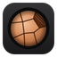

#  Métallo

The microscope capture app of the metallography lab ([ADR 0023](docs/adr/0023-metallo-neutral-dark-theme.md)).

[](https://github.com/FB-UNIV/microscope-app/actions/workflows/ci.yml)

Replacement for the legacy Matrox-based metallography imaging tool. See
[`CONTEXT.md`](./CONTEXT.md) for the domain glossary (Grossissement,
Calibration, Échelle, Vue, TP, Échantillon, Fiche, etc.) and
[`docs/adr/`](./docs/adr/) for every architecture decision and *why* it was
made — read those before changing anything structural here, especially
anything that looks like it could be simplified. Several things in this
codebase look more complex than they need to be on purpose (see ADR 0004
and ADR 0007 in particular); the ADR explains the failure mode it's there
to prevent.

## Current status: Phase 1 core and the capture app (per ADR 0009)

This is the first slice: the `Treatment` pipeline (ADR 0002), `Levels` and
`Échelle` treatments, and `Vue` persistence (ADR 0003 — plain original +
JSON sidecar, non-destructive). It started as pure C++ + OpenCV with no
Qt and no camera — deliberately, so the imaging math and the storage model
could be built and verified without needing a Windows machine, Qt, or a
Moticam attached. Camera capture came next (below), then the Qt 6 capture
app in `app/` (see *Using the app*).

Also built since: `CaptureStation` with the measured Moticam A5 camera
profile and the per-microscope White reference (ADR 0014); the
`Measurement` tool; the legacy lab measurements,
ported bit-exact from the decompiled legacy exe (ADR 0012) — Phase
analysis (`analyzePhases`, plus the `phase_overlay` Treatment) and Dureté
Vickers (`vickersHardness`); the `ICamera` capture abstraction with file
replay and OpenCV backends — the OpenCV one is the production path, since
the lab's Moticam A5 cameras are UVC (ADR 0013); `tools/camera_probe` for
the first hardware check. Each Vue's sidecar keeps the Calibration it was
captured with, tied to the frame size it was measured at (ADR 0015), and
every calibrated capture gets its Échelle automatically (ADR 0017). Nothing
is migrated from the legacy app (ADR 0018).

Each workstation keeps its `WorkstationConfig` — the camera profile (capture
API, frame size, pixel format, exposure, colour temperature), the White
reference, and the Calibrations measured on the mire, each with the frame
size it was measured at (every other Grossissement is derived from the one
measured last, ADR 0020) — in `workstation.json` under the per-user *local* app data
folder (`defaultWorkstationConfigPath()`: `%LOCALAPPDATA%\microscope-app\`
on Windows, so it never roams to another lab PC; `$XDG_CONFIG_HOME` or
`~/.config` elsewhere). First launch loads the Moticam A5 profile with no
Calibrations. Saves are atomic, and a file that can't be read loads as
defaults with an error instead of blocking the app; the next save keeps it
aside as `workstation.json.unreadable` (ADR 0004).
`calibrationForFrame(grossissement, width, height)` refuses a Calibration
measured at another frame size than the camera delivers (ADR 0015).
The A5 profile fixes the exposure at 7.8 ms, measured through the
microscope; brightness is set with the lamp knob.

`VueStore` files every capture under a new, never-reused path:
`<root>/<Department>/<TP>/<Échantillon>/<UTC time>_<random>.tiff`, or
`<root>/Unsorted/` before any TP exists (ADR 0008). Names are made safe as
Windows folder names (`TP 1: Aciers` → `TP 1_ Aciers`). `listVues()` lists
an Échantillon's Vues in capture order. The root is the workstation
config's `vue_root`, by default `vues` beside the config file. Each
Échantillon's Vue principale — the one its TP's Fiche shows (ADR 0016) —
is flagged with `setPrincipale()`, one atomic `vue-principale.json` in its
folder, so two Vues are never flagged at once. `fileVue()` files a Vue into
an Échantillon — an Unsorted one once its TP exists (ADR 0008), or one
captured under the wrong Échantillon: the image moves with its sidecar and
any set-aside sidecar, keeping its capture-time name unless that name is
taken there, and never over another file (ADR 0004). The sidecar moves
first and the image last; a failed move puts back what had moved. A Vue
principale filed away is unflagged in its old Échantillon.

The `Catalog` of Departments → TPs (with the instructions students see) →
Échantillons is `catalog.json`, beside the workstation config. In Phase 1 a
teacher writes it by hand (UTF-8): copy
[`docs/catalog-example.json`](docs/catalog-example.json); an Échantillon may be
a bare string. Names that would share a folder (`Ac1: XC10` and `Ac1/ XC10`,
or `GMP` and `gmp`) are refused with both names. No file means no
catalog, and captures go to Unsorted (ADR 0008). In Phase 2 the same file
becomes the cache of what the API serves (ADR 0007).

**Tried in the lab.** On 2026-10-16 the A5 was probed through the
microscope (probe round 2, [docs/hardware/camera-probe.md](docs/hardware/camera-probe.md)),
and the app was used at a first lab session with a teacher: capture, the
White reference, an x5 Calibration on the mire, and Phase analysis (the
teacher judged the phase map and its colours right). The teacher's
feedback was merged on 2026-10-19: three Vues per Fiche page (ADR 0019),
hiding the side panel, deleting a Vue to the Corbeille, one Calibration
for every objective (ADR 0020), the mire's period as a setting, Phase
analysis on a zone and at the legacy scale (ADR 0021), and measurement
points that can be dragged. Not tried in the lab yet: printing a Fiche, a
derived Calibration checked against the mire, and a real Vickers indent
(see *Next steps*).

**Not yet built:** a catalog editor inside the app, and everything in
ADRs 0004–0008 (the k3s-hosted sync/API/backend) — that's Phase 2,
deliberately deferred. No Motic SDK backend is planned: the A5 doesn't need
one.

## Getting a test build

Every green build of `master` is published as the **latest** pre-release:
[Releases › latest](https://github.com/FB-UNIV/microscope-app/releases/tag/latest).
Its zips are replaced after each merge; a `vX.Y.Z` release is a build that
stays put. No GitHub account is needed to download while the repo is public.

1. Download `microscope_app-windows-<build>.zip` (`camera_probe-windows-<build>.zip`
   is the camera check, see [docs/hardware/camera-probe.md](docs/hardware/camera-probe.md)),
   or with the GitHub CLI:
   ```
   gh release download latest --repo FB-UNIV/microscope-app --pattern 'microscope_app-windows-*.zip'
   ```
2. Right-click the zip › *Properties* › tick *Unblock* › OK (else SmartScreen
   blocks the unsigned exe), then *Extract All*.
3. Run `microscope_app.exe` from the extracted folder, with the DLLs and
   folders beside it: nothing to install, no admin rights. No microscope at
   hand: `.\microscope_app.exe --replay photo.png` (see *Demo PC* below).

The title bar names the build, as the zip does: `Métallo —
v0.1.0-3-gabc1234` is 3 commits after v0.1.0, at commit `abc1234` (just
`abc1234` before the first version). `microscope_app.exe --version` shows it
too, in a message box (`.\microscope_app.exe --version | Out-String` prints
it). Quote it when reporting a problem.

**Publishing a version.** Tag a `master` commit and push the tag:
`git tag -a v0.1.0 -m v0.1.0 <commit>` then `git push origin v0.1.0`. CI
builds the tag, so the exe says `v0.1.0`, and `.github/workflows/release.yml`
publishes release v0.1.0 with both zips and the PRs merged since the
previous version.

## Using the app

`microscope_app` (French UI) on a lab PC, MotiConnect closed:

- **Capture.** Pick *Département › TP › Échantillon* (from `catalog.json`;
  the TP's instructions show on the right), the *Grossissement*, then
  *Capturer* (Space). The live preview runs on a worker thread through a
  `CaptureStation`, so the camera profile is re-applied and the White
  reference baked in exactly as the capture will be. The Vue is filed by
  `VueStore` with the Grossissement's Calibration and its Échelle — or
  without either when that objective isn't calibrated, or was calibrated at
  another frame size than the camera delivers (ADR 0015); the banner says
  which. It also names every camera setting not granted (exposure, colour
  temperature, frame size, pixel format); a camera held by MotiConnect gets
  a message and *Reconnecter la caméra* (F5).
- **Vues.** The right panel lists the Échantillon's Vues, newest first,
  each with its thumbnail and capture time; a new capture is picked in it.
  *★ Principale* (or right-click › *★ Choisir comme Vue principale*) flags
  the one for the Fiche; the Vue buttons wait for a Vue to be picked.
  *Aide › Raccourcis clavier* lists the keys.
  *Masquer les Vues* (F9) hides the panel for a bigger live view; the
  toolbars still show the Échantillon and Grossissement, capture works the
  same, and the choice is remembered in `ui.ini` beside `workstation.json`.
  Double-click opens a Vue: Levels with a live preview, the Échelle,
  removing a Treatment (all saved in the sidecar at once), *Mesurer une
  longueur*, *Dureté Vickers* (two diagonals, load selector, HV0.5 by
  default; the active tool stays pressed and says what to click next,
  Échap puts it away; every point — a yellow ring — can be dragged
  afterwards to correct a reading, its value following live, a right-click
  on one deletes its measurement, and Backspace takes back the last point;
  the cursor is a crosshair, and dragging elsewhere pans), and
  *Analyse de phases* (CALCUL, percentages, histogram with
  the Seuil, the phase map as a Treatment). *Choisir une zone…* (drag a
  rectangle, or click two opposite corners) restricts CALCUL and the map to a zone that
  leaves dust and inclusions out; any zone of at least 5x5 pixels at the
  legacy scale is accepted (no size rule until the teacher sets one, #64),
  and it is saved with the map, outlined in cyan. A 4K photo is analysed at
  the legacy camera's 1042 px width (ADR 0021); when no Seuil can be found
  the app says so instead of giving a %. Measuring is refused on an
  uncalibrated Vue. *Exporter une copie* writes the Vue with its
  Treatments as PNG, TIFF or JPEG; the photo and sidecar are untouched.
- **Filing Vues.** *Classer…* (right-click: *Classer la Vue…*) moves the selected Vue, with its
  Treatments, into the Échantillon picked in a small *Département › TP ›
  Échantillon* dialog. Once a catalog exists, Vues captured before it
  (Unsorted, ADR 0008) are listed with *Vues non classées (N)* above the
  list, until every one is filed. A Vue open in its own window must be
  closed first.
- **Deleting Vues.** *Supprimer…* (button; *Supprimer la Vue…* on
  right-click, Suppr in the list, and in the Vue's own window) asks first, then moves the Vue
  with its Treatments to `Corbeille/` in the Vue folder, under the same
  *Département / TP / Échantillon* folders (`VueStore::deleteVue`). Nothing
  is erased: move its files back to recover it. A deleted Vue principale
  is unflagged, and a window open on it closes. Who may delete is not
  restricted yet.
- **Fiche menu.** *Générer la Fiche du TP* writes the picked TP's Fiche as
  an A4 PDF (ADR 0016): each Échantillon's Vue principale, its name and
  Grossissement, three per page, one per row (`layoutFiche()`, ADR 0019: a
  16:9 photo prints about 133 × 75 mm). The photo prints as captured with
  only its Échelle on top (`fichePhoto()`, ADR 0022): Levels and the phase
  map stay on screen and in exports. An Échantillon without a Vue
  principale gets an empty frame, and the app lists them before writing.
  After writing, it lists what to check, such as a Vue principale whose
  Échelle was removed (it prints without one). Then open the PDF to print
  it (ADR 0010).
- **Poste menu (setup).** *Configurer la caméra* sets up the Camera profile
  without editing a file (#83), the live preview beside every step: the
  cameras found (index, capture API, default mode, like `camera_probe`),
  the mode (frame size, pixel format, DirectShow or Media Foundation) and
  what the camera actually granted, exposure (auto or fixed, with the
  measured frame rate), colour temperature (auto or locked), the White
  reference, then a summary before saving. A mode the camera falls back
  from is saved as the one it delivers; a refused setting is named, never
  saved as granted. It warns which Calibrations stop applying in the new
  mode and offers to calibrate on the mire right after (ADR 0015), and says
  when a new exposure, colour temperature or camera makes the White
  reference stale (ADR 0014). *Rétablir le profil Moticam A5* restores
  `moticamA5Profile()`, keeping the White reference.
  *Mesurer la référence blanche* (blank field, lamp
  on), *Calibrer un grossissement sur la mire* (click a line of the mire
  and the line N periods further — a period is the gap between two
  neighbouring lines, 20 µm on the lab's mire, set in the dialog for
  another mire and kept in `workstation.json` — until two readings agree
  within 0.25 %. Only the distance across the lines counts, in the
  direction found in the image, so the clicks need not be level. One
  objective is enough, the others are derived from it by their
  magnification and the toolbar's tooltip says "Déduit de x5", ADR 0020), *Modifier /
  Recharger le catalogue de TP*, *Ouvrir le dossier des Vues*. Settings are
  saved to `workstation.json`.
- **Demo PC.** These options override the config for one run without
  changing it: `--device N` (a laptop's own webcam is often 0), `--api
  dshow|msmf|auto`, `--size WxH` (`0x0` = device default), and `--replay
  IMAGE` (repeatable) to work on image files with no camera at all (see
  below).

## Trying it without a microscope

1. **Get the app.** Download `microscope_app-windows-<build>.zip` from the
   `latest` release, unblock and extract it (see *Getting a test build*).
2. **Replay lab frames as the camera.** `microscope_app.exe --replay
   frame.png` (repeat `--replay` for several images) previews the image
   instead of a camera; *Capturer* files it as a Vue. The 4K frames of
   probe round 2 (e.g. `r2-exp9\camera_probe_index0.png`, a
   ferrite–pearlite steel at x5; not in the repo) suit Phase analysis.
3. **Calibrate on a synthetic mire.** `python tools/make_mire.py --pitch 31
   --out mire.png` (Python with numpy and opencv-python) draws the lab's
   20 µm mire at 1.55 px/µm, about what the A5 sees at x5, at the A5's
   3840×2160. Run `microscope_app.exe --replay mire.png`, calibrate x5 in
   *Poste › Calibrer un grossissement sur la mire*, and the reading should
   come back at 1.55 px/µm. `--mire-microns` draws a mire of another
   period; set the same period in the dialog. Then restart with `--replay`
   on a lab frame of the same size: x5 captures get that Calibration, the
   other objectives one derived from it (ADR 0020). A Calibration only
   applies to frames of the size it was measured at (ADR 0015): for
   1080p frames, draw the mire with `--size 1920x1080`.

`--replay` uses the Windows user's own `workstation.json` and Vue folder,
so try this on a PC that is not a lab workstation, or under another
Windows user: calibrating on the synthetic mire would replace that
microscope's real Calibration.

## Building

Requires CMake, a C++17 compiler, OpenCV, nlohmann-json, and Qt 6.4+
(Widgets, and Test for the widget tests) for the app. Without Qt, configure with `-DMSAPP_BUILD_APP=OFF`
to build only the core, its tests and `camera_probe`: the core never links
Qt.

```sh
mkdir build && cd build
cmake .. -DCMAKE_BUILD_TYPE=Release
make
./test_pipeline
```

`ctest` also runs `microscope_app --smoke-test` on Qt's offscreen platform:
it shows the `MainWindow` and quits, so it needs no display. There too,
`test_image_view` (QtTest) drives the image view with the mouse: click,
pan, dragging and right-clicking a measurement point, drawing a zone. CI publishes
a ready-to-run Windows bundle of the app (`microscope_app-windows`: exe,
Qt, OpenCV and MSVC runtime DLLs), built with the Qt version pinned in
`.github/workflows/ci.yml`; on `master` it goes to the Releases page (see
*Getting a test build*). CMake stamps `git describe` into the app and
`camera_probe` as the build version when it configures (`-DMSAPP_VERSION=...`
overrides it; a tree without git says `unknown`).

`test_pipeline` synthesizes a low-contrast test image (standing in for a
real capture, so the test needs no camera), runs it through Levels +
Échelle, saves it as a Vue, reloads the Vue from disk, and checks the
reload round-trips pixel-identically. Output images land in
`msapp_pipeline_test/` under the system temp directory (the test prints
their full paths), never in the source tree.

## Layout

```
include/            Public headers for the core lib
src/                 Implementation
app/                 Qt 6 desktop app (MainWindow) — the only code that links Qt; app/tests/ its QtTest widget tests
tests/               Test harness (no test framework dependency — plain asserts + PASS/FAIL output)
CONTEXT.md           Domain glossary — read this first
docs/adr/            Architecture Decision Records — the "why" behind every structural choice
docs/legacy/         Reverse-engineering report of the legacy Metal exe + legacy→new gap analysis
tools/               camera_probe.cpp — lab-PC camera check; legacy_phase_reference.py — independent reference for the phase-analysis port; make_mire.py — synthetic mire to calibrate without a microscope
tests/fixtures/      256×256 crops of legacy views for the phase-analysis parity test
```

## Next steps

1. **Lab session 2**, on the lab PC with the latest bundle (MotiConnect
   closed):
   - Set up the camera with *Poste › Configurer la caméra*
     ([#83](https://github.com/FB-UNIV/microscope-app/issues/83)): the A5
     is listed (DirectShow and Media Foundation), 3840×2160 MJPG is
     granted at about 15 fps, exposure and colour temperature change the
     preview live, a mode change names the Calibrations it invalidates,
     and after *Enregistrer* the preview restarts on the saved profile with
     no banner. Try 1920×1080 too, then *Rétablir le profil Moticam A5*.
     This also replaces editing `workstation.json` by hand: a file saved
     before the exposure was fixed keeps `null` (camera auto), and the
     wizard's exposure step (or the A5 button) sets 7.8 ms.
     Before changing it, one check for
     [#14](https://github.com/FB-UNIV/microscope-app/issues/14): after a
     run at a manual exposure (`camera_probe --exposure -9`), the app with
     `null` should put the camera back in auto exposure.
   - Reprint a Fiche on the lab printer: the photos carry no Levels or
     phase map (ADR 0022), and the Échelle bar is still right against the
     mire on paper.
   - Check a derived Calibration against the mire: with only x5
     calibrated, capture the mire at x10, measure across N periods with
     *Mesurer une longueur* and compare with N × 20 µm (ADR 0020).
   - Photograph a real Vickers indent and read its hardness
     ([#24](https://github.com/FB-UNIV/microscope-app/issues/24)).
   - Note whether the capture banner names any camera setting not
     granted, and whether a blank field comes out neutral after the White
     reference ([#15](https://github.com/FB-UNIV/microscope-app/issues/15)).
2. **Meet the teacher** with the questions in
   [#64](https://github.com/FB-UNIV/microscope-app/issues/64): a minimum
   zone size for Phase analysis, derived Calibrations, Vickers loads,
   what the Fiche shows, who may delete a Vue, how TPs are organised.
3. **Phase 2**: the backend and sync (ADRs 0004–0008,
   [#32](https://github.com/FB-UNIV/microscope-app/issues/32)–[#35](https://github.com/FB-UNIV/microscope-app/issues/35)).

Phase-analysis parity always runs (CI included) on three 256×256 crops of
legacy views in `tests/fixtures/legacy/`. The full-size checks run against
real legacy view TIFFs when given their folder:
`./test_phase_analysis <folder>`, or
`cmake -DMSAPP_LEGACY_DATA_DIR=<folder> ..` then `ctest`. Without it those
print `[SKIP]`. `tools/legacy_phase_reference.py` is the independent
numpy implementation the golden numbers come from.
